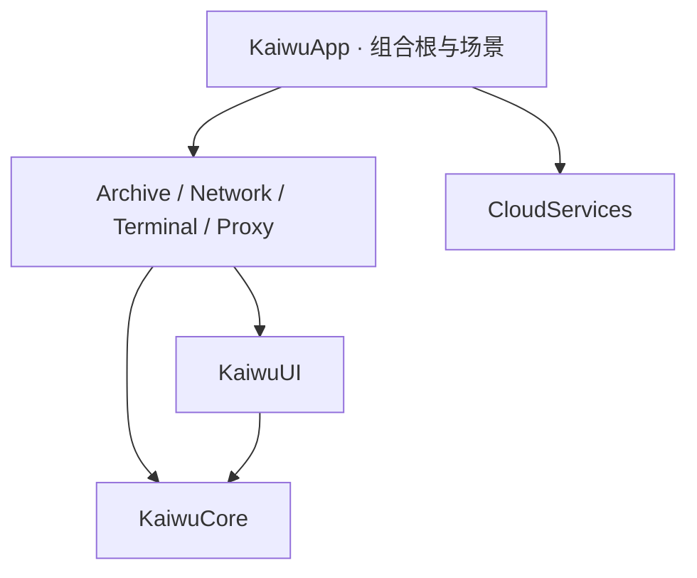

# 架构与扩展

## 平台目录

仓库以 `apps/<platform>/` 放置独立客户端，目前 macOS 的完整工程位于 `apps/macos/`。SwiftPM、Xcode、配置、测试、工具及平台脚本使用平台目录作为构建根；业务模块内部的相对路径保持一致。

根目录 `script/` 与 Makefile 是便捷入口，转发到平台脚本；`.github/` 编排 CI。`docs/` 管理公共规范及设计，`changelog/` 维护版本变化。平台新增方式见 [平台约定](../apps/README.md)。只有存在多个真实消费者时才提取共享包，不让客户端直接引用彼此内部源码。

## 分层依赖

功能模块不互相 import。跨功能的数据交流后续通过 Core 中明确的协议和值类型完成；禁止把 Shell、CloudKit、代理核心实现直接放进 App 导航层。

- **App 层**：`AppServices.live()` 是唯一默认依赖装配入口，场景提供 `WindowGroup` 与独立 `Settings`。
- **Core 层**：只包含可复用模型与基础服务，不 import SwiftUI。
- **UI 层**：`FeatureModule` 暴露稳定 ID、描述与视图工厂，`AnyView` 只用于功能模块边界。
- **Feature 层**：一个功能一个 target，内部按服务、模型和界面拆文件，协议支持测试替身。
- **CloudServices**：独立于具体页面，当前只提供账户适配器、同步契约和白名单模型。

没有动态下载插件或运行用户脚本的机制。这里的“可扩展”是编译期模块注册，减少初始化阶段的复杂度。

## 状态所有权

| 状态 | 所有者 |
| --- | --- |
| 依赖实例 | App 的组合根 |
| 窗口导航 | `@SceneStorage`，每个窗口独立 |
| 表单、结果、任务 | 页面 `@State` 持有表单和 Core `ToolTask`，离开页面请求取消 |
| 持久化规则、探测地址与开关 | 页面与 Settings 共用 `@AppStorage`；键和默认值由所属模块定义 |
| 本机打包书签与成功历史 | 组合根共享 ArchiveLibraryService actor，文件持久化；页面持有展示副本 |
| 控制器 Secret | 页面内存；离开页面清空，后续持久化使用 Keychain |
| 文件处理 | actor 服务，不阻塞主线程 |

较复杂功能可以引入 `@MainActor @Observable` store；不为简单表单添加多余 ViewModel。工具页面离开时统一请求取消，等待操作退出后才能重复启动；首版不提供后台任务队列。已发布的文件和已经交给系统的外部应用启动不回滚。历史列表在进入页面及本页操作后刷新，其他窗口的历史变化在重新进入时读取。

## 新增功能步骤

1. 创建 `apps/macos/Sources/YourFeature/`，按需求添加模型、服务协议、实现与视图。
2. 在 `apps/macos/Package.swift` 增加 target 和 library product，通常依赖 Core / UI。
3. 实现 `FeatureModule`，保证 `descriptor.id` 唯一且发布后稳定。
4. 为 App executable 增加依赖；在 Xcode App target 的 Frameworks, Libraries, and Embedded Content 中加入对应本地 package product。
5. 在 `AppServices.live()` 中注入服务并注册模块；侧边栏与工作台自动显示。
6. 添加模块 README，按模板维护职责、现状、已完成、下一步和验证；在 Package target 中排除 README。
7. 为有行为的服务补充 `apps/macos/Tests/YourFeatureTests`，直接声明测试所 import 的每个本地模块。运行 `make check-all`。

功能模块根目录只保留 `*Module.swift` 入口和 README，具体实现分入 `Models`、`Services`、`Views`。小模块不强制建立未使用的目录。macOS 开发工具单独放在 `apps/macos/Tools`，不链接进 App。

边界规则由 `apps/macos/Tools/RepositoryChecks` 检查；实际依赖以 Package.swift 为准。共同代码格式、状态交接与工作区纪律见 [开发规范](../CONTRIBUTING.md)。

## 系统边界

`ProcessRunner` 使用绝对可执行文件路径与参数数组，无 `/bin/sh -c`。它在后台运行子进程，支持取消、超时、终止升级和限量读取输出。临时文件避免 stdout/stderr 管道阻塞。环境变量不继承用户的代理、ZIP 参数或 shell 配置。该服务只用于受控系统工具，不是用户可配置的命令执行平台。

AppKit 仅用于系统文件对话框、应用启动和 Finder 定位；主界面和状态由 SwiftUI 管理。

修复助手目前只有 `PrivilegedRepairServicing` 和类型化 `RepairAction` 接口，默认实现明确返回不可用。禁止通过拼接 sudo / AppleScript 命令绕开这个边界。

## 当前验证边界

自动测试不访问公网、不修改系统网络，不需要 Ghostty/Mihomo/CloudKit 账户。ZIP 测试运行真实系统 zip/unzip，进程测试验证参数、超时、取消和大输出；网络和控制器测试使用解析样例与构造请求，另以临时回环服务器验证本机 TCP/PAC HEAD 探测。实际外部应用启动、Mihomo API 连接和已签名 CloudKit 需接入后进行集成验收。
